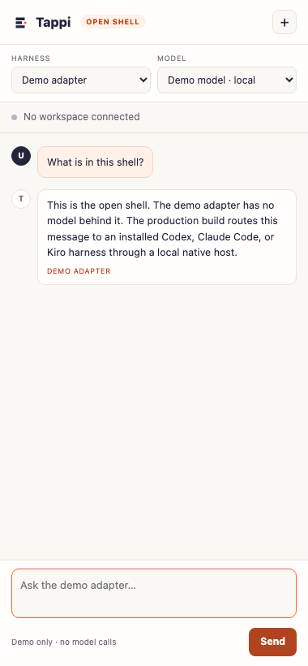

# Tappi for Chrome — open shell

A sanitized, runnable shell of the **Tappi for Chrome** sidebar: a Manifest V3 extension that opens a side panel, presents a harness/model context, and runs a typed adapter contract.

This is not the full product. It is the public architecture slice: the UI shell, the adapter boundary, the demo adapter, and the tests. The native host, real harness adapters, Office add-in, signing, and packaging stay private.



## What the full product does

Tappi for Chrome is a sidebar for installed **Codex**, **Claude Code**, or **Kiro** harnesses. It runs in the user's own Chrome session and adds:

- Native working folders and conversations.
- Selected text and image snips as context.
- Isolated agent tab groups.
- Mobile emulation and editable design previews.
- A bundled Office web add-in for Word, PowerPoint, and Excel.
- Native messaging to a local companion that starts the harness.

Reference metrics for the full product: ~36.5K LOC and 69 test files. The commercial source is private.

## What is in this repo

| Path | What it is |
|---|---|
| `extension/manifest.json` | Minimal MV3 manifest: side panel, storage, active tab, no native messaging |
| `extension/background.js` | Opens the side panel on action click |
| `extension/sidepanel.html` | The sidebar shell |
| `extension/sidepanel.css` | Sidebar styling |
| `extension/sidepanel.js` | Chat loop against the adapter contract |
| `shared/adapter.js` | Adapter contract, validation, demo adapter, manifest guard |
| `tests/extension.test.mjs` | Manifest, CSP, asset, adapter, and secret checks |
| `docs/ARCHITECTURE.md` | The production architecture and the boundary |
| `docs/SECURITY.md` | What the shell can and cannot do |

## Run it

The side panel is a normal web page. To view it without installing the extension:

```sh
npx serve . -l 4330
# open http://localhost:4330/extension/sidepanel
```

To load it in Chrome:

1. Open `chrome://extensions`.
2. Enable **Developer mode**.
3. Choose **Load unpacked** and select the `extension/` directory.
4. Pin Tappi, click the icon, and the side panel opens.

The demo adapter has no model behind it. It returns a fixed message after a short delay, and the UI labels the response **demo adapter**. There are no network calls.

## Test

```sh
npm test
```

The tests check:

- The manifest is MV3 and requests no `nativeMessaging` or `externally_connectable`.
- The extension CSP allows only local scripts and no `eval`.
- The side panel loads no remote assets.
- The demo adapter validates, answers locally, and rejects empty messages.
- The public files contain no obvious secrets or private host paths.

## Architecture

```text
side panel (this repo)
  │  adapter.send({ text })
  ▼
HarnessAdapter (contract, this repo)
  │
  ├── DemoAdapter (this repo) ── fixed local response
  └── NativeAdapter (private)
        │  chrome.runtime.connectNative
        ▼
      local companion (private)
        │  start / stream / cancel
        ▼
      Codex · Claude Code · Kiro
```

The adapter contract is intentionally small:

```js
{
  id: 'demo',
  label: 'Demo adapter',
  listModels: async () => [{ id, label }],
  send: async ({ text, signal }) => ({ text, citations, demo })
}
```

The production adapter adds streaming events, cancellation, harness discovery, model catalogs, workspace roots, and the Office bridge. The shell keeps the same shape so the UI does not depend on a specific harness.

## Why publish this

A technical buyer should be able to see how the product is put together without being handed the keys to the native host or the customer's Office tenant.

This repo shows:

- The extension is a thin UI over a typed adapter, not a pile of page scripts.
- The public manifest cannot request native messaging by accident.
- The side panel has a strict CSP and no remote code.
- The security boundary is explicit: the shell cannot read the filesystem, start a process, or reach Office.

## What is not here

- `nativeMessaging` permission or a native host manifest.
- Harness process launch, streaming, or cancellation.
- Office add-in manifests, certificates, or signing keys.
- Customer workspaces, prompts, recipes, or conversation histories.
- Packaging scripts or update infrastructure.

If you need those, they are part of the commercial product, not this repository.

## Security

The open shell has no native messaging, no filesystem access, no process launch, and no Office connection. It can read the active tab only when the user invokes it (`activeTab`), and it does not inject a content script.

See [docs/SECURITY.md](docs/SECURITY.md) for the boundary and the production controls.

## License

Apache 2.0. See `LICENSE`. The Tappi name and the commercial product are not licensed by this repository.
